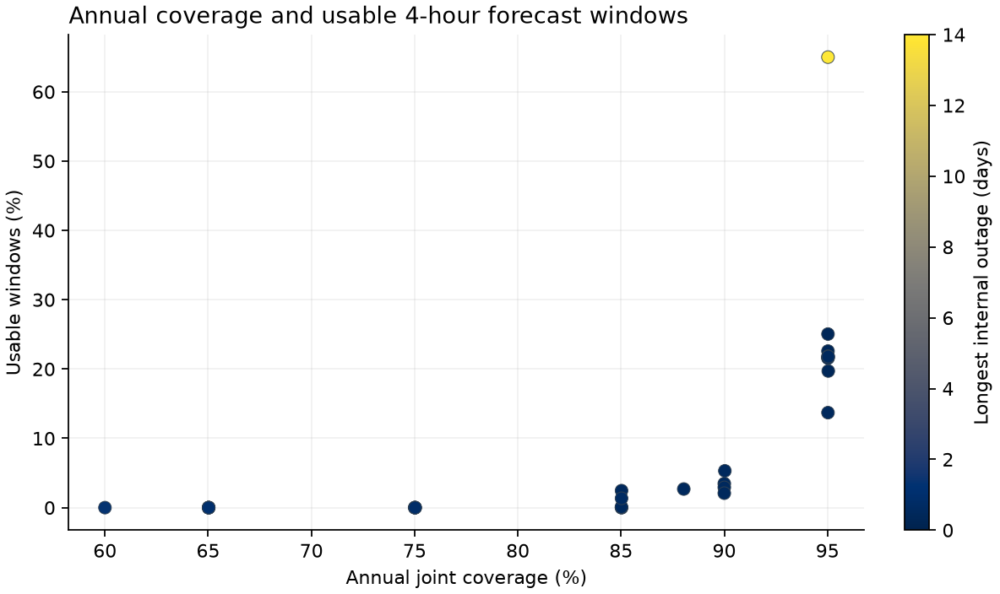

#  水质监测站点筛选与预测样本可用性分析

从 4 小时监测原始记录出发，核查数据质量，比较筛选规则，并评估每个站能提供多少可用于时序预测的完整样本。

## 案例，同样的覆盖率，能用的样本差多少？

在这个**模拟案例**中，SIM_A 和 SIM_F 在 2021 年的四项指标联合覆盖率都为 **95.02%**。SIM_A 的缺测较分散，SIM_F 的一部分缺测集中在 6 月连续 14 天。两站都有 2,160 个理论上可以做提前 4 小时预测的窗口。

| 2021 年模拟站点 | 联合覆盖率 | 最长连续整条缺测 | 可用窗口数 | 可用率 |
| --- | ---: | ---: | ---: | ---: |
| SIM_A | 95.02% | 8 小时 | 488 | 22.59% |
| SIM_F | 95.02% | 14 天 | 1,404 | 65.00% |

在这个案例里，零散的缺测打断了更多连续的输入序列。集中缺测的站点保留了更多完整序列，但连续 14 天没有记录。按年覆盖率可以做初筛。需要连续历史做预测时，还要看可用窗口数。重视持续监测时，还要看最长断档。

## 数据

**sample_raw_observations.csv** 是为展示流程构造的模拟数据，覆盖 6 个虚拟站点和 2021–2025 年。样本包含重复版本、整条记录缺失和单项指标缺失。**sample_data.csv** 是对应的年度汇总示例。

| 字段 | 含义 |
| --- | --- |
| station_id | 虚拟站点编号 |
| observed_at | 观测时间，使用当地时间 |
| source_snapshot_time | 记录版本的快照时间 |
| do、nh3n、ph、codmn | 四项模拟水质指标，空白表示缺测 |

## 分析流程

1. **核对时间与去重**　观测时间必须落在每天 00:00、04:00、08:00、12:00、16:00 或 20:00。同站同一观测时间以最新快照为准。最新快照内容相同的记录合并，内容冲突时报错。
2. **统计缺失与覆盖率**　分别统计整条记录缺失的时点和有记录但指标不完整的时点。四项指标齐全的时点占全年的比例是联合覆盖率。平年有 2,190 个理论时点，闰年有 2,196 个。
3. **比较筛选规则**　在 70%、80%、90% 门槛下分别用五年平均覆盖率和逐年达标规则筛站。例如 SIM_B 五年平均约 84%，但 2023 年只有 60%，在 80% 门槛下会被逐年规则筛除。
4. **量化断档与预测窗口**　分别计算两种最长断档，一种只看整条记录缺失，另一种也把指标不齐算进去。断档在站点当年首次和末次观测之间计算。预测窗口要求连续 30 个历史时点和相应的未来目标时点四项指标均齐全，分别统计 4、12、24、48、72 小时预测时距。输入和目标在同一年，窗口可以重叠。

## 运行

使用 Python 3.13。在项目目录中执行：

~~~sh
python -m pip install -r requirements.txt
python station_screening.py
~~~

用 **--raw-input** 可以指定同格式原始记录。用 **--output** 可以切换结果目录。只运行覆盖率筛选时，可以执行 **python station_screening.py --input sample_data.csv --output coverage_only**。

| 默认输出到 results | 内容 |
| --- | --- |
| annual_data_quality.csv | 每个站点每年的重复、缺失和完整记录统计 |
| station_coverage.csv | 逐站年度覆盖率、五年平均值、最低值和筛选标记 |
| threshold_summary.csv、threshold_comparison.png | 不同门槛下两种筛选规则的通过数量和对比图 |
| forecast_window_diagnostics.csv | 逐站逐年的断档时长和各预测时距的可用窗口数量 |
| coverage_vs_windows.png | 年度覆盖率与提前 4 小时预测的窗口可用率对比 |

本仓库展示独立科研项目的数据质量、站点筛选和预测样本评估环节。示例图表和结果均来自随附的模拟数据。
